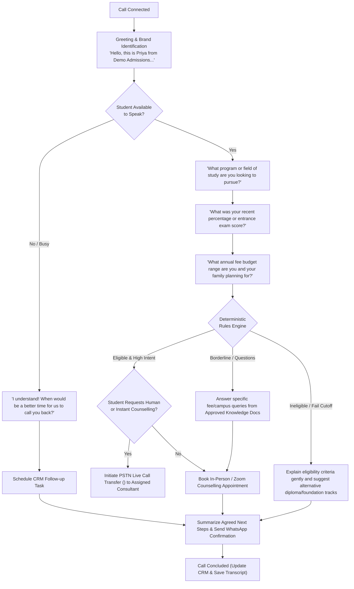

# AI Model Documentation & Guardrails Specification: Admissions AI

**Document Version:** 1.0  
**Repository:** [github.com/PrajyotKore/admissions-ai](https://github.com/PrajyotKore/admissions-ai)  
**Status:** Implemented & Verified  

---

## 1. AI Model Inventory & Stack Overview

The Admissions AI platform integrates a multi-model conversational and reasoning pipeline:

| Pipeline Stage | Model / Service | Purpose | Latency Target |
|---|---|---|---|
| **Speech-to-Text (STT)** | **Google Cloud Speech-to-Text v2 (Chirp)** | Transcribes incoming student caller audio over telephony (8kHz / 16kHz). Tuned for Indian English, Hindi, and regional accents. | < 250ms |
| **Reasoning & RAG** | **Vertex AI (Gemini 1.5 Flash)** | Grounded conversational reasoning, knowledge retrieval, and candidate qualification dialogue. | < 350ms |
| **Structured Extraction** | **Gemini 1.5 Flash (Structured Outputs)** | Extracts structured JSON lead attributes (marks, budget, intake year, next action intent) from raw conversation text. | < 200ms |
| **Text-to-Speech (TTS)** | **Google Cloud Text-to-Speech (Neural2)** | Synthesizes natural, human-like voice response (`en-IN-Neural2-A/D`) with custom SSML pacing. | < 200ms |
| **Simulated Voice Engine** | **MockVoiceProvider Engine** | Deterministic simulation framework with realistic conversational dialogues for local test harnesses and demos (`is_synthetic = True`). | < 50ms |

---

## 2. Knowledge Base Grounding & Anti-Hallucination Architecture

In admissions counselling, hallucinating cutoffs or making unauthorized admission promises creates severe legal liabilities. Admissions AI enforces strict RAG guardrails:

```
+-----------------------------------------------------------------------------------+
|                        KNOWLEDGE INGESTION PIPELINE                               |
|   PDF / Text Course Brochures · Fee Structures · Eligibility Criteria Files       |
+-----------------------------------------------------------------------------------+
                                         │
                                         ▼
                     [ Ingestion / Keyword Fact Parser ]
                                         │
                                         ▼
                      [ Manager Approval Gate Check ]
                     ┌────────────────────────────────┐
                     │ is_approved == True?           │
                     └────────────────┬───────────────┘
                                      │
                   ┌──────────────────┴──────────────────┐
                   │ YES                                 │ NO
                   ▼                                     ▼
        +-----------------------+              +-----------------------+
        | ACTIVE KNOWLEDGE POOL |              | BLOCKED FROM AI POOL  |
        | Searchable by AI Bots |              | Invisible to Models   |
        +-----------------------+              +-----------------------+
                   │
                   ▼
+-----------------------------------------------------------------------------------+
|                            CONVERSATIONAL INFERENCE                               |
|   Student: "What is the fee for B.Tech CSE at partner colleges?"                  |
|   1. Search active knowledge documents for matching course tokens.                |
|   2. Inject approved document text into System Prompt context.                    |
|   3. Model responds strictly from context.                                        |
|   4. If criteria missing -> Fallback: "I do not have verified criteria for this   |
|      course; let me connect you with our senior counsellor."                      |
+-----------------------------------------------------------------------------------+
```

### System Prompt Guardrail Specification
```text
You are Priya, an automated admissions assistant representing {organization_name}.
Your mission is to guide prospective students with verified, accurate admissions criteria.

STRICT OPERATING CONSTRAINTS:
1. ONLY quote cutoffs, fees, or course availability that appear VERBATIM in the APPROVED_KNOWLEDGE_BASE below.
2. If the user asks about a course or college not in the APPROVED_KNOWLEDGE_BASE, you must explicitly state:
   "I don't have verified fee or cutoff information for that program right now. Let me schedule a call with our senior counsellor who can assist you."
3. NEVER guarantee admission, scholarship percentages, or seat reservations under any circumstances.
4. If the student expresses frustration or asks to speak with a human, trigger the transfer protocol immediately.

APPROVED_KNOWLEDGE_BASE:
{approved_document_snippets}
```

---

## 3. Structured Intent & Entity Extraction

After every call attempt, the conversation transcript is processed through structured JSON extraction to synchronize CRM fields:

### Extraction Schema
```json
{
  "summary": "Student was traveling; requested follow-up call tomorrow evening regarding B.Tech Computer Science.",
  "extracted_fields": {
    "academic_marks": 78.0,
    "preferred_course": "B.Tech Computer Science",
    "budget_max": 800000,
    "admission_timeline": "this_year",
    "callback_requested": true,
    "appointment_preferred": "2026-10-27T17:00:00Z"
  },
  "next_action": "Call back tomorrow evening",
  "sentiment": "positive",
  "transfer_requested": false,
  "is_ai_generated": true
}
```

### Field Provenance Tracking
When extracted fields are written to the `Leads` table, the source is recorded as `voice_telephony_agent` with an exact ISO timestamp, ensuring consultants know which attributes were student-declared during the call.

---

## 4. Voice Agent Dialogue Flow & Telephony Trees



---

## 5. Safety, Compliance & Ethical Guardrails

### 5.1 Simulated Call Transparency (`is_synthetic = True`)
In development and demo environments, all simulated voice attempts and billing records must maintain `is_synthetic = True`. In production, the voice bot must announce itself as an automated AI assistant in its opening sentence to comply with global telephony disclosure laws (e.g., FCC TCPA regulations and TRAI guidelines).

### 5.2 Consent Verification Enforcement
The model cannot be invoked for an outbound call unless the student lead has an explicit record in `consent_records` where:
- `purpose == "automated_calls"`
- `status == "granted"`

If a student utters *"Stop calling me"* or *"Do not call this number again"*, the model triggers the DNC intent handler, which immediately:
1. Sets `Lead.do_not_contact = True`.
2. Adds a revocation entry to `consent_records`.
3. Cancels all pending calling jobs for this phone number.
4. Ends the call politely: *"We have updated our records and will not call this number again. Thank you."*

### 5.3 Quiet Hours Telephony Filter
Calls are strictly prohibited between `21:00` (9:00 PM) and `09:00` (9:00 AM) in the candidate's regional timezone. The queue worker calculates local time before dialling and postpones jobs falling outside this window.

---

## 6. Model Evaluation & Performance Metrics

| Evaluation Metric | Target Benchmark | Measurement Method |
|---|---|---|
| **Fact Hallucination Rate** | **0.0%** | Zero tolerance. Checked against approved knowledge base source texts. |
| **Intent Extraction Accuracy** | **> 96%** | Evaluated on benchmark test dialogues across Indian English accents. |
| **Speech-to-Text Word Error Rate (WER)** | **< 8.5%** | Evaluated on 8kHz telephony audio with background ambient noise. |
| **First-Turn Voice Latency** | **< 800ms** | Time from student speech end-point detection to first synthesized audio frame. |
| **DNC Detection Precision** | **100%** | Any negative consent phrase must trigger immediate DNC suppression. |
