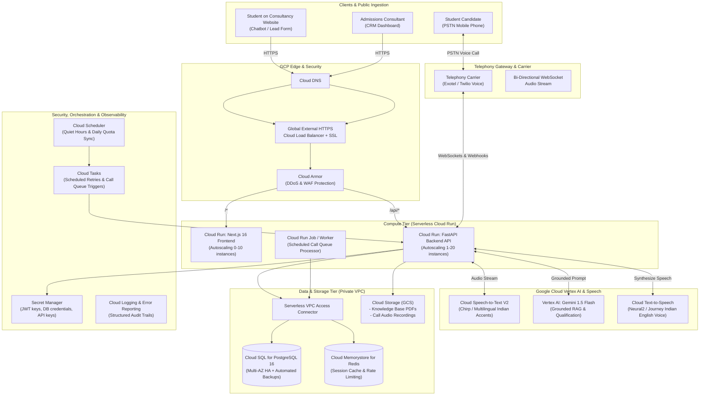
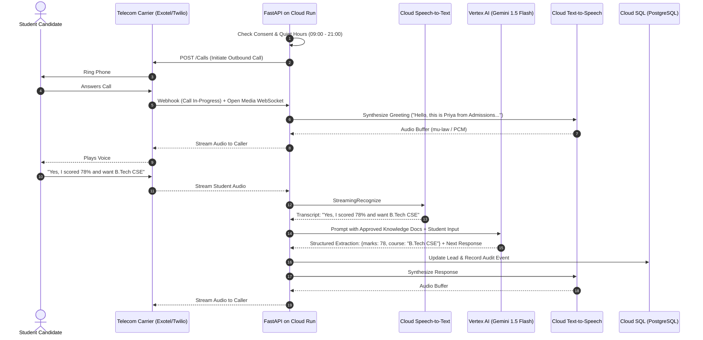

# Admissions AI: Enterprise GCP Cloud Architecture Blueprint

This document specifies the complete, production-grade cloud architecture for deploying the **Admissions AI** CRM and Agentic Voice Telephony platform on **Google Cloud Platform (GCP)**.

Designed for high reliability, strict data compliance (DPDP/GDPR), sub-second voice AI latency, and cost-effective scaling (serverless first).

---

## 1. End-to-End System Architecture



---

## 2. GCP Component Mapping & Service Selection

| Application Component | Recommended GCP Service | Justification & Architectural Benefit |
|---|---|---|
| **Web Dashboard (Frontend)** | **Cloud Run** (Next.js 16 Container) | Serverless, zero maintenance, scales to zero when idle, fast SSR delivery. |
| **API & Business Logic** | **Cloud Run** (FastAPI Container) | Concurrent request handling, automatic scaling, built-in WebSocket support for live audio streaming. |
| **Relational Database** | **Cloud SQL for PostgreSQL 16** | Managed enterprise Postgres, point-in-time recovery, automatic daily backups, private IP VPC peering. |
| **Caching & Rate Limiting** | **Cloud Memorystore for Redis** | Sub-millisecond distributed token bucket rate-limiting and pub/sub for call state events. |
| **Knowledge Base Storage** | **Cloud Storage (GCS)** | Secure bucket for brochures, syllabi, fee structures, and call audio recordings. |
| **AI LLM & Reasoning** | **Vertex AI (Gemini 1.5 Flash)** | Grounded fact checking, structured JSON output extraction, 1M+ token context window, lowest cost and latency. |
| **Speech-to-Text (STT)** | **Cloud Speech-to-Text v2 (Chirp)** | Superior handling of Indian English, Hindi, and regional accents over telephony audio (8kHz/16kHz). |
| **Text-to-Speech (TTS)** | **Cloud Text-to-Speech (Neural2)** | Natural, human-like voice synthesis (`en-IN-Neural2-A/B/C/D`) with custom SSML pacing. |
| **Queue & Scheduling** | **Cloud Tasks + Cloud Scheduler** | Serverless delayed invocation for call queue retries, quiet hour schedules, and appointment reminders. |
| **Security & Secrets** | **Secret Manager** | Centralized encryption of database passwords, JWT secrets, and carrier API tokens with automatic IAM audit trails. |
| **Edge Security** | **Cloud Armor + Cloud Load Balancing** | DDoS mitigation, rate limiting at edge, and Google-managed auto-renewing SSL certificates. |

---

## 3. Real-Time Agentic Voice & Telephony Pipeline

### 3.1 Outbound AI Qualification Call Flow



### 3.2 Live Human Consultant Handoff (Call Transfer)

When a candidate expresses high urgency or requests human guidance:
1. **Detection:** Vertex AI detects transfer intent (`transfer_requested: true` or high qualification score).
2. **Audio Feedback:** The voice bot speaks: *"Allow me to connect you immediately with our senior admissions consultant, Rajesh."*
3. **PSTN Call Bridging:**
   - FastAPI sends a telecom transfer command:
     - **Twilio Voice:** `<Dial><Number>+919876543210</Number></Dial>`
     - **Exotel:** `Call Transfer API` bridging the student leg to the consultant leg.
4. **Fallback:** If the consultant's line is busy or unanswered after 20 seconds, the call bridges back to the agent: *"Rajesh is currently assisting another parent. I have booked an appointment for him to call you back at 4:00 PM."*
5. **CRM Task:** A priority `FollowUpTask` is logged in the CRM with full transcript context.

---

## 4. Multi-Tenant Data Isolation & Security Architecture

### 4.1 Zero-Trust Network Topology
- **Private VPC:** Cloud SQL and Cloud Memorystore Redis operate without public IP addresses.
- **Serverless VPC Access Connector:** Cloud Run services communicate with PostgreSQL and Redis over private internal IPs (`10.8.0.0/28`).
- **Encrypted at Rest & in Transit:** All traffic enforces TLS 1.3. Database volumes use Google-managed or Customer-Managed Encryption Keys (CMEK).

### 4.2 Multi-Tenant Data Protection
- **Tenant Scoping:** Every SQL query filters by `organization_id` injected from authenticated JWT claims.
- **Consent Ledger Integrity:** The `consent_records` and `audit_events` tables are strictly append-only; updates and deletions are blocked by database triggers.
- **Formula Injection Defense:** CSV exports enforce string sanitization on `=,+,-,@` to protect spreadsheet consumers.

---

## 5. Automated CI/CD & Deployment Setup

### 5.1 Infrastructure as Code (Terraform)
The infrastructure can be provisioned via Terraform modules:
- `google_cloud_run_service` for frontend and backend.
- `google_sql_database_instance` for PostgreSQL 16.
- `google_redis_instance` for Memorystore.
- `google_storage_bucket` for knowledge documents.
- `google_secret_manager_secret` for configuration.

### 5.2 Cloud Build Pipeline (`cloudbuild.yaml`)

```yaml
steps:
  # 1. Build and push Backend Container to Artifact Registry
  - name: 'gcr.io/cloud-builders/docker'
    args: ['build', '-t', 'asia-south1-docker.pkg.dev/$PROJECT_ID/admissions/backend:$SHORT_SHA', './backend']
  - name: 'gcr.io/cloud-builders/docker'
    args: ['push', 'asia-south1-docker.pkg.dev/$PROJECT_ID/admissions/backend:$SHORT_SHA']

  # 2. Build and push Frontend Container to Artifact Registry
  - name: 'gcr.io/cloud-builders/docker'
    args: ['build', '-t', 'asia-south1-docker.pkg.dev/$PROJECT_ID/admissions/frontend:$SHORT_SHA', './frontend']
  - name: 'gcr.io/cloud-builders/docker'
    args: ['push', 'asia-south1-docker.pkg.dev/$PROJECT_ID/admissions/frontend:$SHORT_SHA']

  # 3. Deploy Backend to Cloud Run
  - name: 'gcr.io/google.com/cloudsdktool/cloud-sdk'
    entrypoint: gcloud
    args:
      - 'run'
      - 'deploy'
      - 'admissions-backend'
      - '--image=asia-south1-docker.pkg.dev/$PROJECT_ID/admissions/backend:$SHORT_SHA'
      - '--region=asia-south1'
      - '--platform=managed'
      - '--vpc-connector=admissions-vpc-conn'
      - '--set-secrets=DATABASE_URL=admissions-db-url:latest,JWT_SECRET_KEY=admissions-jwt-secret:latest'

  # 4. Deploy Frontend to Cloud Run
  - name: 'gcr.io/google.com/cloudsdktool/cloud-sdk'
    entrypoint: gcloud
    args:
      - 'run'
      - 'deploy'
      - 'admissions-frontend'
      - '--image=asia-south1-docker.pkg.dev/$PROJECT_ID/admissions/frontend:$SHORT_SHA'
      - '--region=asia-south1'
      - '--platform=managed'
      - '--set-env-vars=NEXT_PUBLIC_API_URL=https://api.youradmissionscrm.com/api'

images:
  - 'asia-south1-docker.pkg.dev/$PROJECT_ID/admissions/backend:$SHORT_SHA'
  - 'asia-south1-docker.pkg.dev/$PROJECT_ID/admissions/frontend:$SHORT_SHA'
```

---

## 6. Monthly Cost Estimation (GCP Free Tier & Startup Budget)

### Stage 1: MVP / Launch Stage (0 to 1,000 Leads / Month)
| Service | Tier / Usage | Estimated Monthly Cost |
|---|---|---|
| **Cloud Run (Backend & Frontend)** | 2M requests/mo (Covered by Free Tier) | **$0.00** |
| **Cloud SQL (PostgreSQL)** | `db-f1-micro` (Shared vCPU, 10 GB SSD) | **~$9.50** |
| **Cloud Storage (GCS)** | 5 GB documents & audio recordings | **~$0.15** |
| **Vertex AI (Gemini 1.5 Flash)** | ~200,000 input/output tokens per day | **~$1.20** |
| **Cloud Speech-to-Text v2** | 60 mins/month free, then $0.016/min | **~$3.00** |
| **Cloud Text-to-Speech** | 1M characters free tier | **$0.00** |
| **Secret Manager & Cloud Logging** | Free tier allocation | **$0.00** |
| **Total Estimated MVP Cost** | | **~$14.00 / month** |

### Stage 2: Growth Stage (50,000 Leads, 10,000 AI Voice Calls / Month)
| Service | Tier / Usage | Estimated Monthly Cost |
|---|---|---|
| **Cloud Run** | Multi-instance autoscaling | ~$25.00 |
| **Cloud SQL (PostgreSQL)** | `db-custom-2-7680` (2 vCPU, 7.5 GB RAM, HA) | ~$115.00 |
| **Cloud Memorystore (Redis)** | 1 GB Basic instance | ~$35.00 |
| **Vertex AI (Gemini Flash)** | Heavy qualification & embeddings | ~$18.00 |
| **Cloud STT + Cloud TTS** | ~20,000 voice minutes | ~$280.00 |
| **Cloud Armor + Load Balancer** | Enterprise DDoS & SSL | ~$22.00 |
| **Total Estimated Scale Cost** | | **~$495.00 / month** |

---

## 7. Next Steps for GCP Deployment

1. **GCP Project Setup:** Create GCP project (`admissions-ai-prod`) and enable billing.
2. **Enable Required APIs:**
   ```bash
   gcloud services enable \
     run.googleapis.com \
     sqladmin.googleapis.com \
     redis.googleapis.com \
     secretmanager.googleapis.com \
     speech.googleapis.com \
     texttospeech.googleapis.com \
     aiplatform.googleapis.com \
     vpcaccess.googleapis.com \
     cloudbuild.googleapis.com
   ```
3. **Provision Cloud SQL & VPC Connector** in region `asia-south1` (Mumbai) for low telecom latency.
4. **Deploy Containers via Cloud Build**.
