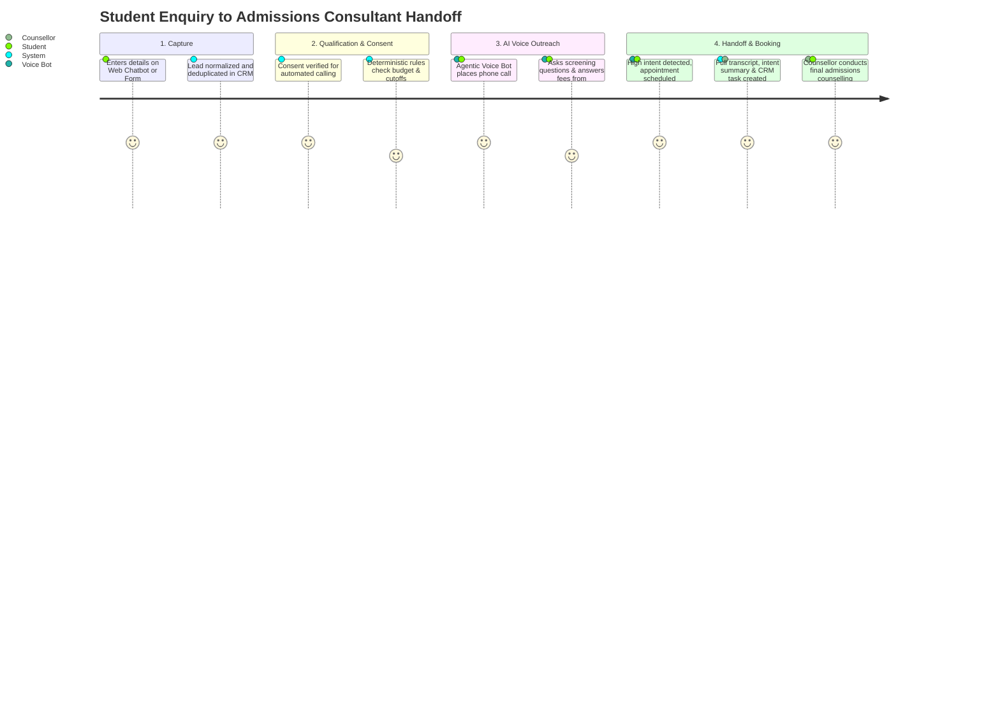

# Product Requirement Document (PRD): Admissions AI Platform

**Product Name:** Admissions AI  
**Document Version:** 1.0  
**Target Market:** Higher Education Admissions Consultancies, Study-Abroad Agencies, and College Placement Firms  
**Status:** Approved / In Implementation  

---

## 1. Executive Summary & Product Vision

**Admissions AI** is a production-grade, multi-tenant SaaS CRM and Agentic Voice Telephony platform engineered specifically for educational admissions consultancies. 

Consultancies spend 40% to 60% of their staff time manually dialling raw student enquiries, qualifying eligibility against college cutoffs, answering repetitive questions about fee structures, and scheduling counselling appointments. 

**Product Vision:** To automate the entire first-contact, qualification, and follow-up journey for candidate leads using an agentic, zero-hallucination AI voice bot that calls students, evaluates eligibility against approved institutional criteria, updates the CRM in real time, and seamlessly bridges qualified, high-intent candidates to human admissions consultants.

---

## 2. Target Personas

| Persona | Role | Key Goals & Pain Points |
|---|---|---|
| **1. Consultancy Owner / Director** | Business Executive | Wants visibility into lead conversion ratios, cost per acquired student, counsellor productivity, and compliance (no spam, strict calling hours, no regulatory fines). |
| **2. Admissions Operations Manager** | Team Lead / Admin | Manages intake sources, assigns leads to counsellors, reviews university course brochures/fee matrices, approves knowledge documents, and oversees the calling queue. |
| **3. Admissions Counsellor / Telecaller** | End-User Staff | Wastes hours dialling unreachable leads. Wants pre-qualified, warm candidates, instant access to conversation transcripts, notes, and automated callback reminders. |
| **4. Student Applicant / Parent** | Customer / Candidate | Wants rapid, accurate answers regarding cutoffs, seat quotas, and fee ranges without waiting days for a callback or suffering aggressive sales spam. |

---

## 3. Problem Statement & Market Opportunity

1. **High Lead Decay Rate:** 70% of students who submit online enquiries choose the consultancy that contacts them within the first 15 minutes. Manual telecalling teams take 4 to 24 hours to respond.
2. **Repetitive Screening Overhead:** Counsellors spend the first 3 minutes of every call verifying basic criteria (12th/Graduation percentage, entrance exam ranks, preferred location, family budget).
3. **Information Hallucination Risk:** Unverified consultants or generic AI chatbots frequently quote incorrect fee structures, fake cutoffs, or unauthorized seat guarantees, creating legal liabilities.
4. **Compliance & Consent Violations:** Telecom authorities (TRAI in India, FCC in the US) strictly penalize calling during quiet hours (e.g. after 9 PM) or contacting users who requested "Do Not Contact" (DNC).

---

## 4. User Journeys

---

## 5. Detailed Functional Requirements

### FR 1: Multi-Tenancy & Access Control
- **1.1 Multi-Tenant Isolation:** Each consultancy operates in strict isolation. All data queries must be filtered by `organization_id`.
- **1.2 Role-Based Access Control (RBAC):**
  - `owner`: Billing, organization configuration, team management, deletion rights.
  - `manager`: Knowledge approval, lead re-assignment, call queue pause/resume, CRM reporting.
  - `counsellor`: Access only to assigned leads, personal follow-up tasks, manual call triggers, and activity timeline.
- **1.3 Session Revocation:** Changing user password or role increments `token_version`, instantly invalidating active JWT bearer tokens.

### FR 2: Omnichannel Lead Intake & Normalization
- **2.1 Indian Mobile E.164 Normalization:** Automatically standardizes numbers into `+91[6-9]\d{9}`.
- **2.2 Zero Silent Merge Conflict Policy:** When duplicate leads enter with conflicting data (e.g., different budget or course), the system increments contact count, appends an activity event, and preserves existing data without silent overwrite.
- **2.3 CSV Bulk Import & Export:**
  - Dry-run import with dynamic column mapping and line-by-line validation errors.
  - CSV export sanitizes spreadsheet formula triggers (`=`, `+`, `-`, `@`) preventing formula injection attacks.
- **2.4 Field Provenance:** Tracks originating source (`website_chatbot`, `walk_in`, `counsellor_edit`, `csv_import`) and timestamp for each lead attribute.

### FR 3: Grounded Knowledge Base (Zero-Hallucination Guardrails)
- **3.1 Document Ingestion:** Consultancies upload official course brochures, fee matrices, seat intake rules, and eligibility criteria (PDF, text, markdown).
- **3.2 Manager Approval Gate:** Ingested documents remain in `pending` state and **cannot be cited** by public chatbots or voice agents until explicitly reviewed and approved by a `manager` or `owner`.
- **3.3 Strict Citation:** AI must respond strictly from approved facts. If criteria for a requested course is missing, the AI states: *"I do not have verified criteria for this course; let me connect you with our counsellor."*

### FR 4: Deterministic Eligibility Qualification Engine
- **4.1 Hard vs. Soft Criteria Separation:**
  - Hard Failures (Disqualification): Academic score below minimum eligibility cutoff; maximum budget strictly lower than lowest institutional fee.
  - Soft Scoring (0–100): Calculated based on admission timeline urgency, exam score margins, and budget alignment.
- **4.2 Categorized Outputs:** Classifies leads into `eligible`, `borderline`, or `ineligible`.
- **4.3 Provenance & Next Recommended Action:** Generates structured records documenting specific pass/fail reasons, missing fields, and actionable next steps.

### FR 5: Agentic Voice Telephony & IVR Bot
- **5.1 Pre-Dial Verification Checklist:**
  1. `automated_calls: granted` consent verified in append-only ledger.
  2. Lead is not flagged `Do Not Contact` (DNC).
  3. Time is strictly between `09:00` and `21:00` in the consultancy's timezone (Quiet Hours enforcement).
  4. Daily call attempt threshold (max 2/day) not exceeded.
  5. Organization calling queue is not paused.
- **5.2 Conversational Flow & Intent Extraction:**
  - Natural greeting citing consultancy brand and verified student name.
  - Interactive qualification questioning (marks, budget, location, session intake).
  - Answers student queries regarding fees and colleges using approved knowledge base facts only.
- **5.3 Simulated / Synthetic Call Labeling:** Every mock attempt and usage billing record is permanently labeled `is_synthetic = True` for auditability.
- **5.4 Post-Call CRM Synchronization:**
  - Full verbatim audio transcript saved.
  - AI conversation summary and structured fields extracted (e.g. `callback_requested`, `budget_confirmed`).
  - Automatic creation of CRM follow-up tasks or appointments based on outcome.

### FR 6: Human Consultant Handoff & Redirection
- **6.1 In-Call Live Transfer:** If a candidate expresses high urgency or requests a human, the voice bot initiates a PSTN call transfer (`<Dial>`) to bridge the student to their assigned counsellor.
- **6.2 Unanswered Fallback:** If the counsellor is unreachable after 20 seconds, the voice bot takes a message, schedules a priority callback task in the CRM, and reassures the student.
- **6.3 Counsellor Notification:** Instant alert in the CRM task manager with caller history, qualification score, and dialogue transcript.

### FR 7: Compliance & Auditability
- **7.1 Append-Only Consent Ledger:** Every consent grant or revocation is recorded with timestamp, actor, and evidence note; rows are immutable.
- **7.2 Instant DNC Suppression:** Setting a lead to `Do Not Contact` immediately revokes all call permissions and cancels all pending queued jobs.
- **7.3 Audit Trails:** Immutable logs for all user logins, settings changes, qualification evaluations, and bulk updates.

---

## 6. Non-Functional Requirements (NFRs)

| Metric | Target Specification |
|---|---|
| **Voice Bot Turn Latency** | < 800ms total roundtrip (Audio Streaming + STT + Gemini Flash + TTS). |
| **API Response Time** | P95 < 120ms for standard CRUD and search endpoints. |
| **Availability (SLA)** | 99.9% uptime on serverless cloud compute. |
| **Data Security & Privacy** | TLS 1.3 in transit, AES-256 at rest, strict tenant data segregation, DPDP Act & GDPR compliant. |
| **Throughput & Scalability** | Capable of processing 50,000 leads/month and 50 concurrent voice calls per tenant. |

---

## 7. Success Metrics & KPIs

1. **Lead Contact Rate:** Increase lead contact rate from industry average 22% to > 65%.
2. **Speed to Lead:** Reduce first outreach attempt from 4 hours to < 90 seconds post-submission.
3. **Counsellor Efficiency:** Save 3.5 hours per counsellor per day by eliminating cold screening dials.
4. **Qualification Accuracy:** Zero hallucinations on college cutoffs or fee ranges through manager-approved knowledge grounding.
5. **DNC / Compliance Breach Rate:** Exactly 0 unauthorized calls during quiet hours or to DNC-flagged leads.
