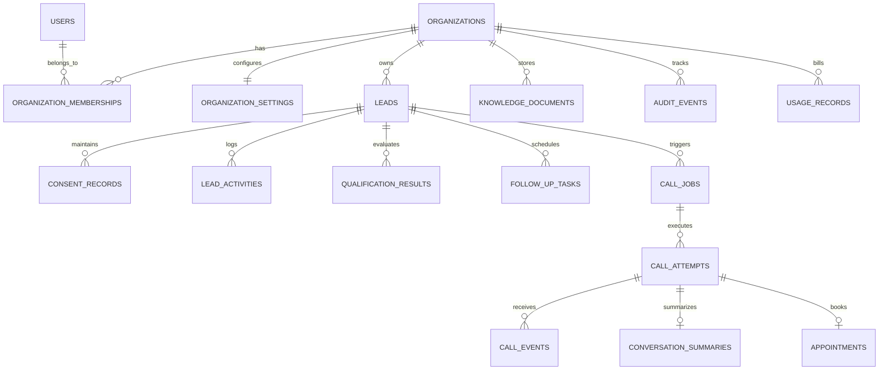
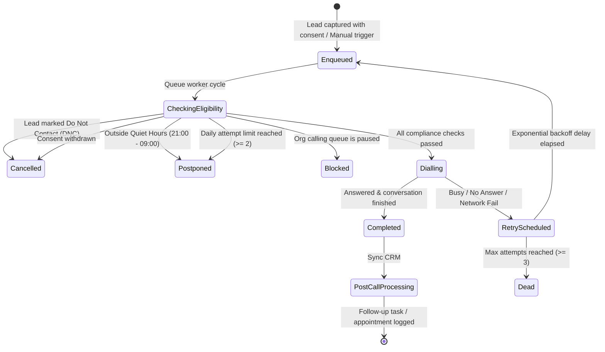

# Technical Architecture & System Specification: Admissions AI

**Document Version:** 1.0  
**Repository:** [github.com/PrajyotKore/admissions-ai](https://github.com/PrajyotKore/admissions-ai)  
**Status:** Implemented & Verified  

---

## 1. System Architecture Overview

Admissions AI is architected as a modular, decoupled full-stack platform:
- **Presentation Layer:** Next.js 16 (React 19, TypeScript, Tailwind CSS v4, App Router) delivering responsive CRM pages and embeddable widgets.
- **API & Application Layer:** Python 3.12 FastAPI service handling authentication, multi-tenant authorization, qualification logic, knowledge RAG, and calling orchestration.
- **Data Layer:** SQLAlchemy 2.0 ORM with PostgreSQL (Cloud SQL in production, SQLite for local development) and Alembic migrations.
- **Telephony & Voice Layer:** Extensible `VoiceProvider` interface with `MockVoiceProvider` (synthetic test harness) and cloud telecom carriers (Twilio / Exotel).

```
+-----------------------------------------------------------------------------------+
|                                PRESENTATION TIER                                  |
|   Next.js 16 App Router · Dashboard · Leads CRM · AI Calls · Knowledge · Widgets |
+-----------------------------------------------------------------------------------+
                                         │ HTTPS REST / Bearer JWT / X-Organization-Id
                                         ▼
+-----------------------------------------------------------------------------------+
|                                APPLICATION TIER                                   |
|                          FastAPI (Python 3.12 / Uvicorn)                          |
|  ┌─────────────────────┐  ┌─────────────────────┐  ┌───────────────────────────┐  |
|  | Auth & Multi-Tenant |  | Leads CRM & Consent |  | Deterministic Qual Engine |  |
|  └─────────────────────┘  └─────────────────────┘  └───────────────────────────┘  |
|  ┌─────────────────────┐  ┌─────────────────────┐  ┌───────────────────────────┐  |
|  | Knowledge Base RAG  |  | Call Queue Worker   |  | Webhook Event Processor   |  |
|  └─────────────────────┘  └─────────────────────┘  └───────────────────────────┘  |
+-----------------------------------------------------------------------------------+
                  │                                         │
                  ▼                                         ▼
+------------------------------------+   +------------------------------------------+
|             DATA TIER              |   |             TELEPHONY TIER               |
|  PostgreSQL 16 / SQLAlchemy 2.0    |   |  VoiceProvider Interface                 |
|  19 Relational Multi-Tenant Tables |   |  - MockVoiceProvider (is_synthetic=True) |
|  Alembic Migration Versioning      |   |  - Twilio / Exotel Carrier Gateway       |
+------------------------------------+   +------------------------------------------+
```

---

## 2. Database Schema & Entity Relationships

The database comprises 19 relational tables ensuring multi-tenant isolation, data provenance, and immutable compliance ledgers:



### Key Data Entities

1. **`Leads` Table:**
   - Stores student demographic and academic data (`name`, `phone`, `email`, `preferred_course`, `preferred_college`, `education_level`, `academic_marks`, `preferred_location`, `budget_min`, `budget_max`, `admission_timeline`).
   - `field_provenance` (JSON): Stores origin source and timestamp per field (e.g. `{"preferred_course": {"source": "website_chatbot", "at": "2026-10-26T16:03:00Z"}}`).
   - `do_not_contact` (Boolean): Master suppression flag.

2. **`ConsentRecord` Table:**
   - Append-only compliance ledger.
   - Records `purpose` (`automated_calls`, `marketing`, `data_processing`), `status` (`granted`, `withdrawn`), `source`, and `evidence` (note, IP address, user-agent).

3. **`QualificationResult` Table:**
   - Stores audit history for deterministic qualification evaluations.
   - Records `category` (`eligible`, `borderline`, `ineligible`), `priority_score` (0–100), `hard_failures` (JSON array), `reasons` (JSON array), `missing_fields` (JSON array), and `next_action`.

4. **`CallJob` & `CallAttempt` Tables:**
   - `CallJob`: Tracks scheduled background dial attempts, retry counters, triggers (`manual`, `auto_intake`), and status (`queued`, `running`, `completed`, `retry`, `dead`, `cancelled`).
   - `CallAttempt`: Records individual call execution, `provider`, `is_synthetic` (True/False), `duration_seconds`, `cost_cents`, `outcome`, `transcript`, and timestamps.

5. **`KnowledgeDocument` Table:**
   - Knowledge files uploaded by consultancies.
   - Contains `is_approved` boolean flag; AI models are strictly blocked from retrieving facts where `is_approved = False`.

---

## 3. Telephony State Machine & Queue Processing

The calling engine enforces a strict legal compliance state machine before dialling:



### Pre-Dial Verification Logic (`backend/app/voice/queue.py`)
```python
def check_calling_eligibility(db: Session, org_id: str, lead: Lead, enforce_quiet_hours: bool = True):
    settings = db.get(OrganizationSettings, org_id)
    if settings.calling_paused:
        raise CallingIneligibleError("Calling queue is currently paused for this organization")
    if lead.do_not_contact:
        raise CallingIneligibleError("Lead has requested Do Not Contact (DNC)")
    if not has_consent(db, lead.id, "automated_calls"):
        raise CallingIneligibleError("No valid consent recorded for automated calls")
    if enforce_quiet_hours and not is_within_calling_hours(settings.timezone):
        raise CallingIneligibleError("Outside permitted calling hours (09:00 - 21:00)")
    if daily_attempt_count(db, lead.id) >= 2:
        raise CallingIneligibleError("Daily call attempt limit reached (max 2 per day)")
```

---

## 4. Deterministic Qualification Engine

Unlike unconstrained LLM evaluators that hallucinate eligibility, Admissions AI runs a **deterministic rules engine** (`backend/app/qualification.py`) with transparent factor provenances:

```python
def evaluate_qualification(lead: Lead, criteria: CourseCriteria) -> QualificationResult:
    hard_failures = []
    soft_score = 0
    reasons = []

    # 1. Hard Cutoff Checks
    if lead.academic_marks is not None and lead.academic_marks < criteria.min_marks_percent:
        hard_failures.append(f"Academic marks ({lead.academic_marks}%) below required cutoff ({criteria.min_marks_percent}%)")

    if lead.budget_max is not None and lead.budget_max < criteria.min_tuition_annual:
        hard_failures.append(f"Maximum budget (Rs.{lead.budget_max}) below minimum annual tuition (Rs.{criteria.min_tuition_annual})")

    # 2. Soft Scoring (0 - 100)
    if not hard_failures:
        if lead.academic_marks and lead.academic_marks >= criteria.min_marks_percent + 15:
            soft_score += 40
            reasons.append("Academic score is significantly above cutoff threshold")
        if lead.admission_timeline in ("immediate", "this_year"):
            soft_score += 30
            reasons.append("High urgency: targeting immediate academic intake")
        if lead.budget_max and lead.budget_max >= criteria.min_tuition_annual * 1.5:
            soft_score += 30
            reasons.append("Budget comfortably covers tuition and accommodation")

    category = "ineligible" if hard_failures else ("eligible" if soft_score >= 50 else "borderline")
    return QualificationResult(category=category, priority_score=soft_score, hard_failures=hard_failures, reasons=reasons)
```

---

## 5. Security & Data Protection Specifications

1. **SQL Injection Defense:** All queries utilize SQLAlchemy 2.0 parameterized statements (`select(...)`, `where(...)`). No string concatenation is permitted in SQL queries.
2. **Formula Injection Defense:** CSV exports escape spreadsheet formula execution characters:
   ```python
   def sanitize_csv_cell(val: Any) -> str:
       s = str(val or "")
       if s and s[0] in ("=", "+", "-", "@", "\t", "\r"):
           return "\t" + s
       return s
   ```
3. **Session Revocation:** JWT bearer tokens include a `ver` (token version) claim matching `User.token_version`. Resetting a password or updating a role revokes all existing sessions immediately.
4. **Rate Limiting:** Public endpoints (`/api/public/chat`, `/api/public/lead`, `/api/auth/forgot-password`) enforce IP-based and key-based sliding window rate limits.

---

## 6. API Endpoint Contracts

### Telephony & Voice
- `POST /api/calls/trigger/{lead_id}?execute_now=true` — Triggers an immediate call attempt.
- `GET /api/calls/queue` — Lists pending call jobs with scheduled run times.
- `POST /api/calls/queue/pause?paused={bool}` — Organization-wide pause kill-switch.
- `POST /api/calls/queue/process` — Executes due call jobs.
- `GET /api/calls/history?page={int}&outcome={str}` — Historical calls with outcome filters.
- `GET /api/calls/attempts/{id}` — Full dialogue transcript and conversation intelligence.

### Student Leads CRM
- `GET /api/leads` — Query leads with search, filters, and pagination.
- `POST /api/leads` — Create lead with E.164 normalization and duplicate checking.
- `GET /api/leads/{id}` — Full student profile with field provenance.
- `PATCH /api/leads/{id}` — Update profile fields with origin tracking.
- `POST /api/leads/{id}/consent` — Append-only consent grant or withdrawal.
- `POST /api/leads/{id}/qualify` — Re-evaluate qualification engine.

---

## 7. Testing & Verification Runbook

### Backend Test Suite
```bash
cd backend
.\.venv\Scripts\python -m pytest -v
```
**Coverage:** 43 tests passing across `test_crm.py`, `test_dashboard_admin.py`, `test_qualification_capture.py`, and `test_voice_calling.py`.

### Frontend Type & Lint Verification
```bash
cd frontend
npm run lint         # 0 errors, 0 warnings
npx tsc --noEmit     # 0 type errors
npm run build        # 15 static and partial-prerender routes compiled
```
